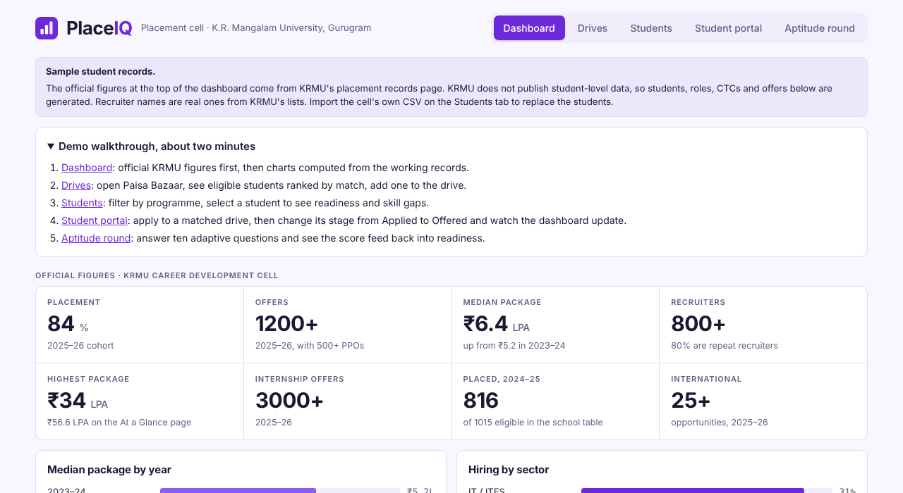

# KRMU PlaceIQ

A placement management system for the Career Development Cell (CDC) at K.R. Mangalam University, Gurugram. It shows the university's official placement figures, runs campus drives, scores student readiness, matches students to drives, and includes an adaptive aptitude round.

It is a static web app. There is no backend, no database and no build step.



## Features

| Screen | What it does |
| --- | --- |
| **Dashboard** | Official KRMU figures first (placement rate, offers, medians, sector split, school-wise table with data-quality flags), then analytics computed live from the working records. |
| **Drives** | Add and filter campus drives. For each drive: eligible students ranked by match score, applicants, and a stage selector (Applied, Shortlisted, Interview, Offered, Rejected). |
| **Students** | Search and filter the cohort, ranked by readiness. Each profile shows the score breakdown, skills, skill gaps, applications, best open matches, and plain-language reasons a student is not eligible for a drive. CSV import and export. |
| **Student portal** | What a student sees: **alerts** about new openings, drive reminders, shortlists, interviews and offers (with an unread count on the tab); an **upcoming drives** list with countdowns; a dated **prep plan** per drive with tickable steps saved per student; and the usual profile. A "Viewing as" selector and a demo date picker stand in for sign-in. Alerts appear in the app only; email, WhatsApp or push need a backend. |
| **Aptitude round** | Ten adaptive questions. A correct answer raises the difficulty, a wrong answer lowers it. The score feeds back into the student's readiness. |

More screenshots are in [`docs/screenshots`](docs/screenshots).

## Quick start

PlaceIQ uses native ES modules, which browsers will not load from a `file://` address. Serve the folder with any static server:

```bash
# Node
npm start                 # serves http://localhost:3000

# or Python
python3 -m http.server 3000
```

Then open http://localhost:3000.

## Project structure

```
placeiq/
├── index.html                 App shell: header, tabs, mount points, script entry
├── assets/
│   └── favicon.svg
├── css/
│   ├── tokens.css             Design tokens: colours and fonts, light and dark (white and violet)
│   ├── base.css               Reset, body, headings, form controls, focus ring
│   ├── layout.css             Header, tabs, banner, panels, grids, headline strip
│   └── components.css         Bars, tables, pills, lists, forms, quiz, toast
├── js/
│   ├── main.js                Entry point: load state, wire events and routing
│   ├── app.js                 render() and hash routing
│   ├── events.js              All user interaction (event delegation)
│   ├── config.js              Constants: storage key, stages, programmes, score weights
│   ├── data/
│   │   ├── official.js        Official KRMU figures and data-quality notes
│   │   ├── drives.js          Seed drives (real recruiter names, example roles and CTCs)
│   │   ├── questions.js       Aptitude question bank (18 items, 3 levels)
│   │   └── names.js           Name pools for the sample generator
│   ├── core/                  Logic with no DOM access
│   │   ├── scoring.js         Eligibility, readiness score, match score
│   │   ├── quiz.js            Adaptive round engine
│   │   ├── csv.js             Student CSV import and export
│   │   ├── sample.js          Seeded sample-cohort generator
│   │   ├── selectors.js       Read-only queries over the state
│   │   ├── store.js           State object, load and save (localStorage)
│   │   └── util.js            clamp, seeded random number generator
│   ├── ui/
│   │   ├── dom.js             $, escaping, formatting, toast
│   │   └── components.js      Bar chart, KPI tile, stage dropdown
│   └── views/                 One module per tab
│       ├── dashboard.js
│       ├── drives.js
│       ├── students.js
│       ├── portal.js          # alerts, upcoming drives, prep plan, profile
│       └── practice.js
├── tests/
│   ├── unit/                  43 tests for scoring, quiz, CSV, official data and sample data
│   └── e2e/smoke_test.py      Browser walk-through of every tab (18 checks)
├── docs/
│   ├── ARCHITECTURE.md        How the pieces fit, and the path to a real backend
│   ├── DATA.md                What is official, what is sample, and where sources disagree
│   ├── PlaceIQ_Project_Report.pdf
│   └── screenshots/
├── .github/workflows/ci.yml   Runs the unit tests and the browser test on every push
├── package.json               Scripts only, no dependencies
├── vercel.json                Static hosting config with basic security headers
├── LICENSE                    MIT (code only, see Data below)
└── CONTRIBUTING.md
```

## Tests

```bash
npm test                  # 43 unit tests, Node 18 or newer, nothing to install

pip install playwright && python -m playwright install chromium
npm run test:e2e          # browser walk-through, starts its own server
```

Set `CHROME_PATH` to use an already installed Chrome, and `SCREENSHOTS=some/dir` to save screenshots.

## Deploy

PlaceIQ is plain static files, so any static host works.

**Vercel**: import the repository at vercel.com/new, set the framework preset to *Other*, leave the build command empty and the output directory as the root. Or from a terminal: `npx vercel --prod`.

**GitHub Pages**: in the repository, go to Settings, then Pages, choose *Deploy from a branch*, select `main` and the `/ (root)` folder.

**Netlify**: drag the folder onto app.netlify.com/drop, or connect the repository with no build command.

## Using your own data

| To change | Edit |
| --- | --- |
| Official figures and the data-quality notes | `js/data/official.js` |
| Drives | `js/data/drives.js`, or use *Add a drive* on the Drives tab |
| Students | Paste a CSV on the Students tab (columns: `name, roll, branch, cgpa, backlogs, skills, aptitude, projects, internships`; separate skills with semicolons; the last three columns are optional) |
| Colours (light and dark) and fonts | `css/tokens.css`. Every colour in the app comes from these tokens, so changing them re-themes everything. Keep both the light block and the two dark blocks in step. |
| Programmes and their skill pools | `PROGRAMMES` in `js/config.js` |
| Readiness and match weights | `READINESS_WEIGHTS` and `MATCH_WEIGHTS` in `js/config.js` |
| Aptitude questions | `js/data/questions.js` (keep at least six per level) |

If you change the shape of the saved state, bump `STORAGE_KEY` in `js/config.js` so browsers discard the old saved copy.

## Data

- The figures in `js/data/official.js` are published by K.R. Mangalam University on its placement records page and in the CDC annual reports. They were read on 31 October 2026 and do not update by themselves. Where those sources disagree, the app says so. See [docs/DATA.md](docs/DATA.md).
- KRMU does not publish student-level data. The 120 students, their applications and offers are **generated sample data**, marked with a banner in the app. Recruiter names are real ones from KRMU's lists; roles, CTCs and dates are examples.
- Real student records are personal data. If you import them, keep the repository private or do not commit them, and check your institution's data protection obligations.

## Limitations

- State is saved in the browser (localStorage), per device. Two officers do not see each other's changes.
- There is no sign-in. The Student portal is a view selector, not a secure login.
- The readiness weights are a transparent starting rule, not a model trained on outcomes.

[docs/ARCHITECTURE.md](docs/ARCHITECTURE.md) describes the recommended path to a shared backend, authentication and role-based access.

## License

MIT for the code. See [LICENSE](LICENSE).
